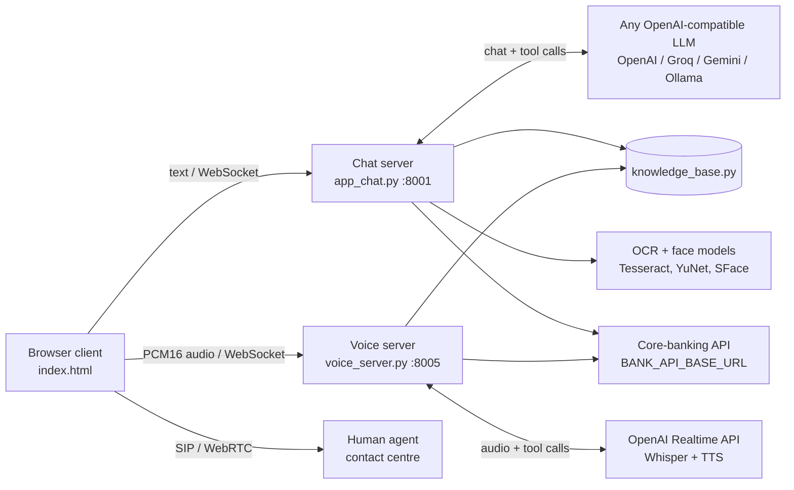

# Amelia: AI Voice and Chat Banking Assistant

Amelia is a banking assistant that customers can **talk to or chat with**. It answers questions from the bank's own knowledge base, performs account actions through LLM tool calls (balance, transfers, transaction history, card blocking), reads cheques and ID documents with OCR, runs a **video KYC check with face matching and liveness detection**, and hands the conversation over to a human agent when needed.

I built it as a working prototype: a FastAPI backend, a real-time voice server, and a single-page web client. The goal was to see how far one engineer can get on a multi-modal assistant (text, speech, images and video) before it needs a team.

> The bank in this repo is a fictional **"Demo Bank"**, and all product data in `knowledge_base.py` is sample content. The core-banking API is configurable, so you can point it at your own mock or test server.

---

## What it does

| Area | What I built |
|---|---|
| **Real-time voice** | Speech-to-speech over WebSockets using the OpenAI Realtime API. Whisper transcribes the user, server-side VAD detects turns, and **barge-in** lets the user interrupt Amelia mid-sentence. Audio is streamed as 16 kHz/24 kHz PCM16 from the browser. |
| **LLM agent with tools** | 6 function-calling tools: `authenticate_user`, `check_balance`, `create_transaction`, `get_last_transactions`, `block_card`, `transfer_call`. The model must call a tool for account data and is not allowed to answer those questions from memory. |
| **Grounded answers** | General questions are answered only from the knowledge base. A token-overlap check (`_is_from_kb`) flags answers that don't come from it, and off-topic questions get a polite refusal instead of an invented answer. |
| **Video KYC (computer vision)** | Face detection with **YuNet** and face matching with **SFace** (OpenCV ONNX models), comparing the ID photo with the video. **Liveness check:** the user must turn their head left and right. Yaw is estimated from facial landmarks, and the check rejects videos with more than one face, poor lighting, blur, or a face that's too small. |
| **Document intelligence** | OCR (Tesseract, with optional EasyOCR) for Aadhaar, PAN, passports and address proofs. Includes Aadhaar **Verhoeff checksum** validation, PAN format checks, name matching between documents, and DOB extraction. |
| **Cheque processing** | Checks the cheque layout, then reads the bank name, the MICR code and the amount with OCR. Validates them against configurable rules before calling the debit API. |
| **Safety rules** | Customers must log in (last 4 digits, phone, DOB, MPIN) before any account action. Transactions are only shown for an account that matches the login. Card blocking needs only the last 4 digits. Credentials are masked in logs. |
| **Human handoff** | Live chat with a human agent over WebSocket, and voice escalation to a contact centre over SIP/WebRTC. The agent receives the transcript plus an AI-generated summary and sentiment. |

---

## Architecture



| File | Role |
|---|---|
| `app_chat.py` | FastAPI chat backend: WebSocket chat, LLM tool calling, KYC, cheque and OCR endpoints, human-agent chat |
| `voice_server.py` | Real-time voice bridge between the browser and the OpenAI Realtime API, sharing the same tools |
| `knowledge_base.py` | Bank knowledge that the assistant is allowed to talk about (sample data) |
| `index.html` | Web client: chat UI, voice mode, KYC recorder, cheque upload, agent handoff |

---

## Running it locally

**Requirements:** Python 3.11+ and Tesseract OCR (`sudo apt install tesseract-ocr` or `sudo dnf install tesseract`).

```bash
git clone https://github.com/Ayush7725/amelia-ai-assistant.git
cd amelia-ai-assistant
python -m venv .venv && source .venv/bin/activate
pip install -r requirements.txt

cp .env.example .env              # add your LLM key
cp config.example.js config.js    # only needed for SIP / agent handoff

# Face models for video KYC (OpenCV Zoo)
mkdir -p models
curl -L -o models/face_detection_yunet_2023mar.onnx \
  https://github.com/opencv/opencv_zoo/raw/main/models/face_detection_yunet/face_detection_yunet_2023mar.onnx
curl -L -o models/face_recognition_sface_2021dec.onnx \
  https://github.com/opencv/opencv_zoo/raw/main/models/face_recognition_sface/face_recognition_sface_2021dec.onnx

python app_chat.py        # chat backend on :8001
python voice_server.py    # voice backend on :8005 (needs a real OpenAI key)
python -m http.server 8080
```

Then open http://localhost:8080/index.html.

The chat backend works with **any OpenAI-compatible provider**. Set `OPENAI_BASE_URL` and `OPENAI_MODEL` for Groq, Gemini, OpenRouter or a local Ollama model. Voice mode needs a real OpenAI key because it uses the Realtime API.

### Core-banking API contract

Amelia doesn't hold account data itself. It calls these endpoints under `BANK_API_BASE_URL`, so a simple mock server is enough for a demo:

| Endpoint | Used for |
|---|---|
| `POST /auth` | Login check (`last4`, `mobile`, `dob`, `mpin`) and balance |
| `POST /transfer` | Create a transfer |
| `POST /transactions` | Last N transactions for an account |
| `POST /block-card` | Block a card by last 4 digits and type |
| `POST /cheque-debit` | Debit after a cheque has been validated |

---

## Example

```
User:   What is the interest rate on a personal loan?
Amelia: The interest rate for a personal loan starts at 10.5% per annum.

User:   What is the capital of France?
Amelia: I'm sorry, I don't have information about that at the moment.

User:   Check my balance
Amelia: To check your balance I need to verify you first. Please share the last
        4 digits of your account number, your registered phone number and your
        date of birth...
```

---

## What I learned

- **Prompt rules alone aren't enough for safety.** The model sometimes asked for the MPIN in the wrong place, or answered account questions without calling a tool. The safety-critical checks (login state, account ownership) need to live in code, with the prompt as a second layer.
- **Liveness is harder than face matching.** Matching faces with SFace was quick to get working. Spotting a photo held up to the camera took more effort, and the random head-turn challenge with a landmark-based yaw estimate was the simplest approach that held up.
- **The thresholds that work on paper fail on real webcams.** The original blur threshold flagged every normal laptop webcam as "blurry". I had to measure real devices (Laplacian variance of about 30–80) and retune it.
- **Voice needs different turn-taking from chat.** VAD is switched off during the greeting so users can't accidentally interrupt it, then switched on so barge-in works for the rest of the call.

## Honest limitations

This is a prototype, not a production system:
- Session state is kept in memory, and there are no automated tests yet.
- The "grounded answer" check is a simple token-overlap heuristic, not a proper retrieval and citation pipeline.
- Liveness detection is a heuristic. It would not stop a determined deepfake or replay attack.
- The knowledge base is written straight into the prompt, which won't scale to a real bank's documentation.

## What I'd do next

- Replace the prompt-stuffed knowledge base with **RAG** (embeddings, retrieval, and answers that cite their source chunks).
- Build an **evaluation harness** that measures accuracy, hallucination rate, refusal rate, latency per turn and cost per conversation.
- Benchmark open-source **STT/TTS** (Whisper variants, IndicTrans, open TTS models) against the Realtime API on Indian-language speech for latency and quality.
- Add **multilingual support** for Hindi and other Indian languages, for both text and voice.

---

**Built by Ayush Agarwal** · [LinkedIn](https://www.linkedin.com/in/ayush-agarwal-038863254/) · ayushagarwal2603@gmail.com
